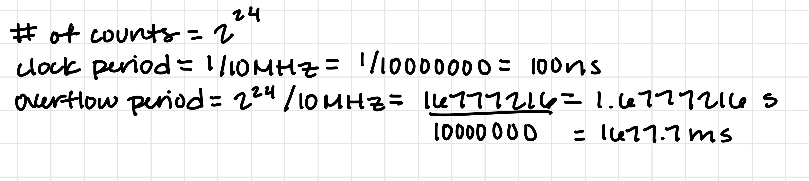

# ece528\_fall26\_homework2

# Section I: Review Questions

1\. A hardware timer is a peripheral that counts clock pulses independently of the CPU. The hardware timers on the MSP432 include: SysTick, Timer_A, Timer32, Watchdog Timer, and Real-Time Clock (RTC).

The kinds of tasks embedded systems commonly use hardware timers are for pulse-width and frequency measurement, PWM generation, and time measurement.

2\. A clock signal in embedded systems is used as a periodic digital signal that supplies timing edges for CPU operations and peripheral activity. The frequency supplied to the clock signal determines how fast operations would run.

**Primary Clock Sources**: Auxiliary Clock (ACLK), Master Clock (MCLK), Subsystem Master Clock (HSMCLK), Low-Speed Subsystem Master Clock (SMCLK), and Low-Speed Backup Domain Clock (BCLK).

Auxiliary Clock (ACLK): Has a restricted maximum frequency of 128 kHz.

Master Clock (MCLK): Used by the CPU and peripheral module interfaces.

Subsystem Master Clock (HSMCLK): Used in the MSP432 clock system as a subsystem for the master clock. You can retrieve the frequency of this clock signal. It is also important for the SMCLK in having a clock resource.

Low-Speed Subsystem Master Clock (SMCLK): Uses the HSMCLK clock resource selection. SMCLK is also limited in frequency to half of the rated maximum frequency of HSMCLK.

Low-Speed Backup Domain Clock (BCLK): This clock signal is restricted to a maximum frequency of 32.768 kHz.

3\. The maximum count before a 16-bit counter rolls over is 0xFFFF

Maximum count = 2^16 - 1 = 65,535 = 0xFFFF

4\. The overflow period would be: 1,677.7216 ms

5\. The SysTick timer is one of the MSP432's hardware timer/timer peripheral. The SysTick timer is located on the CPU, and is defined as a 24-bit countdown timer that generated periodic interrupts.

Applications for the SysTick timer include: Generating precise time delays, and implementing PWM for controlling LEDs or motors.

The sources that a SysTick timer could use are the Processor clock (HCLK), and HCLK/8, which is a prescaled version of HCLK.

In order to use it: CLKSOURCE can either be 0(HCLK/8) or 1(HCLK).

6\. The SysTick timer has four 32-bit registers; its reload and current-count fields are 24 bits wide.
**Registers:** STCSR, STRVR, STCVR, and STCR.
STCSR (CMSIS: SysTick->CTRL): Controls counter enable, exception enable, and clock selection; COUNTFLAG reports that zero has been reached.

STRVR (SysTick->LOAD): Holds the value reloaded for the next countdown.

STCVR (SysTick->VAL): Reports the current count. Writing any value clears the count and COUNTFLAG; the next timer clock reloads the counter.

STCR (SysTick->CALIB): Read-only calibration information, including TENMS, SKEW, and NOREF. On this device TENMS is zero (no known calibration), and NOREF and SKEW read as one. It is not a programmable period register.

7\. The Timer_A peripheral on the MSP432P401R is a 16-bit counter with up to 7 capture / compare registers. It has four operating modes, selectable clock sources, and configurable PWM outputs.

**Four main operating modes of Timer_A:** Stop, Up, Continuous, and Up/Down.

Stop (00): The timer is halted.

Up (01): The timer repeatedly counts from zero to the value of TAxCCR0.

Continuous(10): The timer repeatedly counts from zero to 0xFFFF.

Up/Down(11): The timer repeatedly counts from zero up to the value of TAxCCR0 and back down to zero.

8\. 
TAxCTL: Used to configure the general operation of the Timer_A peripheral (clock source selection, clock divider, timer mode selection, clearing the timer, and overflow interrupt enable(TAIFG))

TAxCCTLn: Controls the behavior of each individual capture / compare channel block within Timer_A. Each block has its own CCTL register to handle specific features (input and output capture, interrupt generation) 

TAxR: Holds the current 16-bit timer count.

TAxCCRn: The CCR registers are used for compare and capture modes. Compare mode is when Timer_A value (TAxR) is compared against this register. Capture mode is when the Timer_A value is copied into the register when a capture happens. Each timer has multiple CCR registers. 

TAxIV: Used for Timer_A interrupts, and also tells you which interrupt has happened.

TAxEX0: Allows you to further divide down the frequency of the selected clock source. (Typically not used in class) 

9\. PWM stands for pulse width modulation and is a technique where the pulse width encodes or modulates a signal. PWM is commonly used for (1) manipulating the brightness of LEDs, (2) Motor control, and (3) battery charging.

10\. Timer_A has 4 modules, Timer_A0, Timer_A1, Timer_A2, Timer_A3. There would be 4 PWM outputs for each timer module when CCR0 sets
the PWM period in up or up/down mode. (Total = 16)

11\.
Timer clock = 12,000,000 / 2 = 6,000,000 Hz
Up/down period = 2 * CCR0 / timer clock
CCR0 = 0.020 * 6,000,000 / 2 = 60,000 = 0xEA60
CCR1 = CCR0 / 2 = 30,000 = 0x7530
High time = 2 * CCR1 / 6,000,000 = 0.010 s
Duty cycle = CCR1 / CCR0 = 50%

Code for #11:
void Timer_A0_PWM_Init(void)
{
    // SMCLK (0x0200), divide by 2 (0x0040), stop, and clear (0x0004).
    TIMER_A0->CTL = 0x0244U;
    TIMER_A0->EX0 = 0x0000U;       // TAIDEX = 000: divide by 1.

    TIMER_A0->CCTL[0] = 0x0000U;   // No CCR0 interrupt.
    TIMER_A0->CCTL[1] = 0x0000U;   // Reset channel before configuration.
    TIMER_A0->CCTL[2] = 0x0000U;
    TIMER_A0->CCTL[3] = 0x0000U;
    TIMER_A0->CCTL[4] = 0x0000U;
    TIMER_A0->CCR[0] = 0xEA60U;    // 60000: 20 ms in up/down mode.
    TIMER_A0->CCR[1] = 0x7530U;    // 30000: 50% duty cycle.

    // OUTMOD = 010 (0x0040); initial OUT = 1 (0x0004); CAP = 0.
    TIMER_A0->CCTL[1] = 0x0044U;

    P2->DIR  |= 0x10U;            // P2.4 output.
    P2->SEL1 &= ~0x10U;
    P2->SEL0 |= 0x10U;            // SEL1:SEL0 = 01: primary TA0.1.

    // SMCLK, divide by 2, up/down (0x0030), and clear/start.
    TIMER_A0->CTL = 0x0274U;
}

12\.
Counts = 12,000,000 * 0.002 = 24,000
Up-mode period = (CCR0 + 1) / 12,000,000
CCR0 = 24,000 - 1 = 23,999 = 0x5DBF

Code for #12:

volatile uint32_t timer_a0_ticks = 0U;

void Timer_A0_Interrupt_Init(void)
{
    NVIC->ICER[0] = 0x00000100U;   // Disable IRQ 8 during setup.

    // SMCLK (0x0200), ID = 00 (divide by 1), stop and clear.
    TIMER_A0->CTL = 0x0204U;
    TIMER_A0->EX0 = 0x0000U;       // TAIDEX = 000: divide by 1.
    TIMER_A0->CCTL[0] = 0x0000U;
    TIMER_A0->CCTL[1] = 0x0000U;
    TIMER_A0->CCTL[2] = 0x0000U;
    TIMER_A0->CCTL[3] = 0x0000U;
    TIMER_A0->CCTL[4] = 0x0000U;
    TIMER_A0->CCR[0] = 0x5DBFU;    // 23999: 24000 ticks per period.
    timer_a0_ticks = 0U;
    TIMER_A0->CCTL[0] = 0x0010U;   // CCIE = 1; CCIFG = 0; compare.

    NVIC->IP[8] = (NVIC->IP[8] & 0x1FU) | 0x40U; // Priority 2.
    NVIC->ICPR[0] = 0x00000100U;   // Clear stale IRQ 8 pending state.
    NVIC->ISER[0] = 0x00000100U;   // Enable IRQ 8.

    // SMCLK, divide by 1, up mode (0x0010), clear/start, TAIE = 0.
    TIMER_A0->CTL = 0x0214U;
        __enable_irq();               // Enable interrupts at the CPU.
}